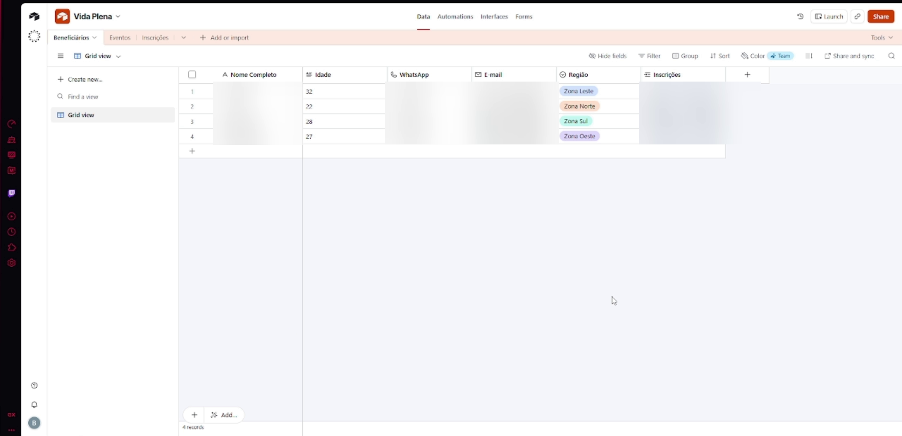
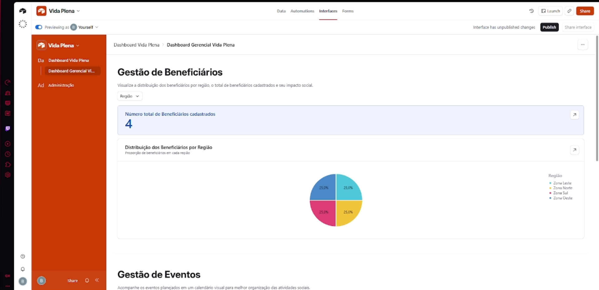
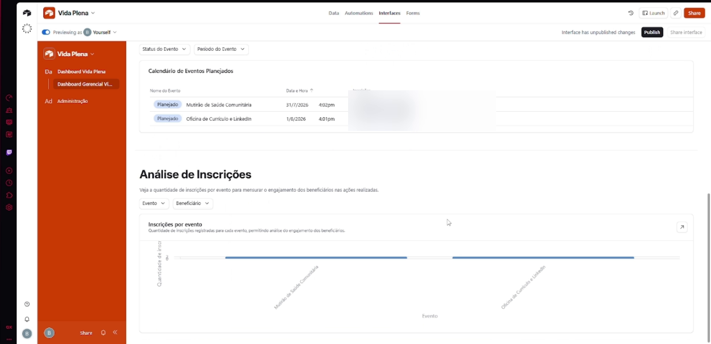
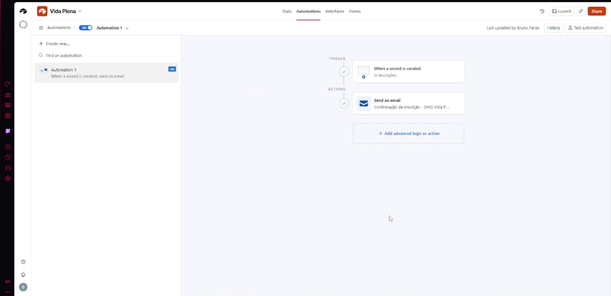

# Governança de dados e automação no-code para uma ONG

> Projeto acadêmico de **banco de dados visual no Airtable**: modelagem relacional, interfaces para a equipe, dashboard de indicadores e automação de e-mails, aplicado ao cenário de uma ONG de capacitação social.

**Curso:** Gestão de Tecnologia e Sistemas de Informação, UniFECAF · **Autor:** Bruno de Campos Farias · **Ferramenta:** Airtable

## Cenário

A ONG Vida Plena (cenário do trabalho) controlava beneficiários, oficinas e inscrições em planilhas soltas e mensagens de WhatsApp. Isso gerava cadastros duplicados, falta de histórico de presença e nenhuma visão consolidada para prestar contas a parceiros.

O desafio foi substituir esse controle por um sistema centralizado, sem escrever código, que a equipe e os voluntários conseguissem usar no dia a dia.

## O que foi construído

### 1. Modelagem relacional

Três tabelas com relacionamento **muitos-para-muitos**:

```
Beneficiários ──< Inscrições >── Eventos
```

| Tabela | Função |
| --- | --- |
| **Beneficiários** | Cadastro único das pessoas atendidas, com região de São Paulo |
| **Eventos** | Oficinas, mutirões e capacitações, com data e status |
| **Inscrições** | Tabela associativa que liga beneficiário e evento, evita duplicidade e registra presença |



### 2. Dashboard de indicadores

Interface com total de beneficiários, distribuição por região, calendário de eventos e inscrições por evento, pensada para a coordenação acompanhar o alcance da ONG.





### 3. Painel administrativo

Interface separada em que voluntários cadastram, editam e excluem registros sem mexer nas tabelas brutas.

### 4. Automação de e-mail

Sempre que uma inscrição é criada, a automação busca o e-mail do beneficiário pelo relacionamento (lookup) e envia uma confirmação com o evento, a data e o horário.



## LGPD

- **Minimização:** coleta apenas os dados necessários para o atendimento.
- **Segregação de perfis:** voluntários operam o cadastro do dia a dia; dados consolidados ficam com a coordenação.
- **Neste repositório:** os dados pessoais nos prints foram borrados, e a base não é compartilhada publicamente.

## Resultado

Sistema entregue funcionando, com relacionamentos, interfaces e automação ativos. A estimativa do projeto é reduzir em até 85% o trabalho administrativo da equipe ao eliminar cadastros duplicados e confirmações manuais. Por ser um trabalho acadêmico, esse número é uma estimativa e não foi medido em operação.

O relatório de entrega está em [`docs/relatorio-de-entrega.pdf`](docs/relatorio-de-entrega.pdf).

## Aprendizados

- Modelar bem as relações antes de criar telas evita retrabalho: a tabela de inscrições é o que garante a integridade dos dados.
- Ferramentas no-code permitem entregar um sistema útil rápido, mas exigem o mesmo cuidado com dados pessoais de qualquer sistema.
- A mesma estrutura serve para escolas, mutirões de saúde ou controle de treinamentos em empresas.
